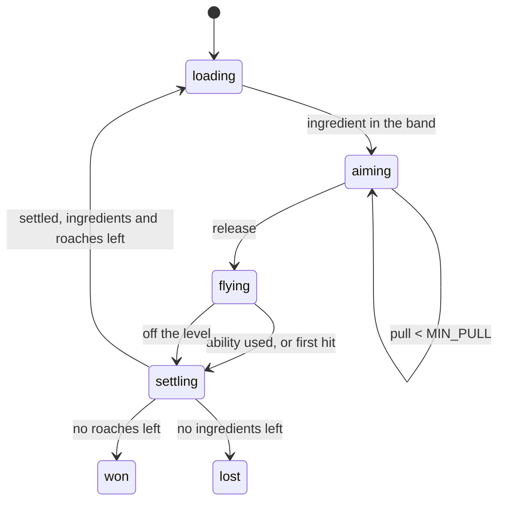

# Gameplay

How the game plays. Physics details (units, damage formula, blasts, settling): [physics.md](physics.md). Level format: [level-design.md](level-design.md). The characters behind each kind: [narrative.md](narrative.md).

## The shot

1. **Load.** The next ingredient in the level's queue hops into the fork's rubber band.
2. **Pull.** The player drags back from the band (mouse or touch). The pull is clamped to `MAX_PULL` px; its direction and length set the launch angle and speed.
3. **Preview.** While pulling, a dotted arc shows the first part of the flight (`PREVIEW_DOTS`). It ignores collisions on purpose: it shows aim, not outcome.
4. **Release.** The ingredient becomes a dynamic body with an initial velocity of `pull × LAUNCH_SPEED`, opposite to the pull. **Decision:** a velocity, not an impulse, so every ingredient flies the same arc for the same pull and the preview never depends on mass.
5. **Ability.** Once per flight, a click/tap or Space triggers the ingredient's ability ([Ingredients](#ingredients)).
6. **Settle.** The shot ends when every body has stopped moving or after `SETTLE_TIMEOUT` frames, whichever comes first. The spent ingredient is removed with a puff, so it never props up a fort later. Then the next ingredient loads, or the level ends.

Releasing with a pull shorter than `MIN_PULL` cancels the shot; the ingredient stays loaded.

## Ingredients

One new ingredient per place. Each ability is what the real food would do.

| Ingredient | Body | Ability (one tap in flight) | Good against |
| ---------- | ---- | --------------------------- | ------------ |
| Meatball | Circle, medium mass | None | Glass, light wood |
| Pea pod | Rounded box | Bursts into `PEA_COUNT` peas, fanned by `PEA_SPREAD`, each with the pod's velocity | Wide forts of glass |
| Chili | Small rounded box | The spice kicks in: `CHILI_BOOST` px/s more along its heading | Wood, thin walls |
| Cheese wheel | Large circle, high mass, high friction | Spins forward at `CHEESE_SPIN` rad/s, so it rolls on when it lands | Cast iron, the base of a fort |
| Popcorn kernel | Small circle, light | Pops: a blast of `POP_RADIUS` around it, then it is gone | Packed towers, pressure cookers |

## Materials

Every block has a material. Properties live in one table in `config.ts` (`MATERIALS`), never in the block code.

| Material | Shapes | Density | Friction | Bounce | Hp | Destroyed |
| -------- | ------ | ------- | -------- | ------ | -- | --------- |
| Glass | Glasses (box), plates (thin box) | Low | Low | Low | Very low | Shatters into shards |
| Wood | Cutting boards, pillars (box) | Medium | Medium | Low | Medium | Splinters |
| Cast iron | Pans, pots (box, circle) | High | High | Very low | High | Breaks into chunks |
| Jelly | Blocks (box) | Low | High | Very high | Unbreakable (infinite hp) | — (wobbles on every hit) |
| Pressure cooker | Pots (circle) | Medium | Medium | Low | Low | Explodes: a blast like the popcorn's |

Blocks show damage in three states, intact, cracked, and broken, by hp fraction (`DAMAGE_STATES`). Debris is visual only, never physics.

## Roaches

Roaches are the level's goal. They have hp like blocks and take damage the same way: impacts, falls, crushing, blasts. A roach that leaves the level (below `KILL_Y` or past its sides) counts as gone.

| Roach | Hp | Radius |
| ----- | -- | ------ |
| Roach | `ROACH.hp` | Small |
| Capped roach | 2 × | Small |
| Colander roach | 4 × | Small |
| The Queen | 10 × | Large |

## Win, lose, and scoring

- **Win:** no roaches left. The last one triggers `FINAL_SLOWMO`; the level ends when the world settles.
- **Lose:** the last shot settles and a roach is still there.
- **Score** (**Decision:** for destruction, not damage, so the numbers are easy to read): each block destroyed scores its material's `score`, each roach its kind's `score`, and each unused ingredient `UNUSED_INGREDIENT_BONUS` at the end of a won level.
- **Chef's hats:** 1 for winning; 2 and 3 at the level's own score thresholds (`stars` in the level data). The thresholds are always visible (**Decision:** [implementation-plan.md › Decisions](implementation-plan.md#decisions), 24):
  - **While playing,** a bar under the score marks both thresholds with a hat, gold once passed. A lighter stretch after the score shows the bonus the ingredients still left would add with a win right now, so the player sees that winning with fewer shots is what reaches the third hat.
  - **In the Result,** each hat shows what it asks for (`Win`, then the two scores), the score is broken down into roaches, fort, and ingredients left, and a won level without three hats says how many points the next one needed.
- **How the thresholds are set** ([level-design.md › The MVP levels](level-design.md#the-mvp-levels)): 2 hats for the roaches and about half of the fort; 3 hats for the roaches, most of the fort, and one ingredient to spare.
- The best score and hats per level are saved ([technical.md › Global state](technical.md#global-state)).

## Feedback

- Impact flash on the block hit, and a screen shake scaled to the impulse, capped (`SHAKE_MAX`).
- Score numbers float up from what was destroyed.
- **The camera** ([implementation-plan.md › Step 8](implementation-plan.md#step-8-camera-090)): a level wider than the screen opens on its fort and pans back to the fork. The camera follows the ingredient in flight, frames the fort while it settles, and returns to the fork for the next shot. A level that fits one screen never moves.
- Slow motion when the last roach goes; only the steps per second change ([physics.md › The step](physics.md#the-step)).
- A one-line hint the first time a place's new ingredient is loaded.

## Controls

| Action | Mouse / touch | Keyboard |
| ------ | ------------- | -------- |
| Aim and pull | Drag from the band | — |
| Launch | Release | — |
| Ability | Click / tap in flight | Space in flight |
| Restart level | Restart button | R |
| Pause | Pause button | Esc |
| Look around (while aiming) | Drag away from the band | A / D |
| Zoom (while aiming) | Wheel | W / S |

The bindings live in `config.ts` (`KEYS`). The player's own pan and zoom hold until the next launch. *After the MVP:* keyboard aiming (arrows).

## Structure

- **The MVP:** five levels, one per place (`1-1` to `5-1`), each built around its place's new ingredient or material, in one Level select.
- *After the MVP:* more levels per place, with the curve in [level-design.md › Difficulty curve](level-design.md#difficulty-curve), and a Place select.
- A level unlocks when the one before it is won.

## Decisions

Open and confirmed decisions about gameplay live in [implementation-plan.md › Decisions](implementation-plan.md#decisions).
