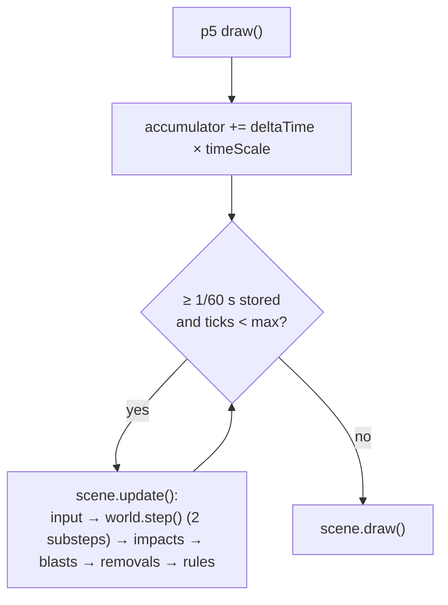

# Physics

How the simulation works and the rules the code follows to keep it stable, fair, and repeatable. Mechanics built on top of it: [gameplay.md](gameplay.md).

## Engine

**Matter.js** (`matter-js`, with `@types/matter-js`). It works in pixels and has a simple API; its weak points for this genre are known and handled below: stacks that jitter ([Stability](#stability)), fast bodies that tunnel through thin ones ([Tunneling](#tunneling)), and contact impulses that can't measure a hit ([Impact damage](#impact-damage)).

## Isolation

- Only `src/physics/` imports Matter. It exposes a `World` and opaque `BodyHandle`s ([implementation-plan.md › Step 1](implementation-plan.md#step-1-physics-sandbox-020)).
- Everything outside sees **px**, **px/s**, **radians**, and plain `Vec = { x, y }`. Matter measures velocity per 1/60 s step; `World` converts to and from px/s, so no other module knows it.
- Entities hold a `BodyHandle`, read its position and angle to draw, and never write them.

## Units

- Lengths in px. Nothing smaller than `MIN_BODY_SIZE` (12 px, a pea) is ever created.
- `GRAVITY = 1000` px/s², pointing down. Screen and world both grow `y` downward.
- Mass is Matter's: `density × area`. Densities live in `MATERIALS` and `INGREDIENTS`; only their ratios matter.

## The step

- A fixed `1/60` s tick, counted in frames; never `deltaTime`. The `SceneManager`'s accumulator runs at most `MAX_STEPS_PER_FRAME` ticks per draw; owed whole ticks past the cap are dropped, so a slow machine slows down instead of catching up in bursts.
- Each tick runs `SUBSTEPS` (2) Matter updates of `1/120` s with the same delta every time. Halving the step halves the distance a body moves per update, which is what keeps fast bodies from tunneling.
- Solver iterations: `POSITION_ITERATIONS` and `VELOCITY_ITERATIONS`, raised from Matter's defaults (6 and 4) until the levels pass the self-collapse test.
- Slow motion scales the time fed to the accumulator (`timeScale`), never the step size.

## Bodies

| Thing | Body | Shape | Notes |
| ----- | ---- | ----- | ----- |
| Floor | Static | Box | Friction from `COUNTER`. |
| Blocks | Dynamic | Box, circle | Density, friction, restitution from `MATERIALS`. |
| Roaches | Dynamic | Circle | Slightly bouncy; hp from the roach kind. |
| Ingredient in the band | **No body** | — | Drawn by the launcher; the body is created on release. |
| Ingredient in flight | Dynamic | Circle, box | `frictionAir` 0: the aim preview stays honest. After its first hit, `LANDED_FRICTION_AIR`: Matter has no rolling resistance, so without it a meatball would roll forever and the shot would only settle on the timeout. |

Bodies are created in the order the level data lists them, so a level builds identically every time. Matter picks a pair's restitution as the larger of the two and friction as the smaller: jelly makes everything that hits it bounce.

## Stability

Matter's solver is weaker than Box2D's on tall stacks. The rules that keep forts standing:

- Every piece snaps to the 16 px grid and touches its support exactly, never overlapping ([level-design.md › Building levels](level-design.md#building-levels)).
- Sleeping is **off**. Matter doesn't wake a sleeping stack when its support is removed, which would leave a fort floating in the air.
- Solver iterations are raised instead, and `levels/settle.test.ts` proves every level stands still on its own.
- No damage during the first `LEVEL_START_GRACE` frames, while the fort settles by a fraction of a pixel.

## Tunneling

Matter has no continuous collision. With 2 substeps, a body moves at most `MAX_LAUNCH_SPEED / 120` px per update; `config.test.ts` checks that this stays below `MIN_BODY_SIZE`, so a launched ingredient always meets a 16 px plate in at least one update.

## Impact damage

Matter's accumulated contact impulse is reset to zero on fast hits, so it can't measure them. Damage comes from the hit itself instead:

- Matter's `collisionStart` fires before the solver runs, while the bodies still have their incoming velocities. For each new pair, `World` records an **impact**: the closing speed along the contact normal times the pair's reduced mass (`ma·mb / (ma + mb)`, or the moving body's mass against a static one). It keeps one per pair per tick: the largest across the substeps. After the step, `world.takeImpacts()` hands them over and clears them.
- Damage to each side: `max(0, impact − DAMAGE_THRESHOLD) × DAMAGE_SCALE × fragility`, where `fragility` comes from the side's own material or roach kind. A falling board crushing a roach is a new pair, so it counts; resting contact never starts a pair, so a fort standing still never hurts itself.
- Bodies at 0 hp are removed **after** the step, never inside an event: changing the world mid-step corrupts Matter's pairs.
- Ingredients never take damage; jelly has no hp.

`damageFromImpact(impact, fragility)` is a pure function with tests.

## Blasts

The popcorn's pop and a destroyed pressure cooker both make a blast at a point.

- Every dynamic body whose center is within the blast's radius gets a velocity change away from the center of `strength × falloff / mass` (an impulse) and damage of `BLAST_DAMAGE × falloff × fragility`, where `falloff = 1 − distance / radius`, so cast iron shrugs a blast off as it does a hit. Line of sight is ignored.
- **Chains:** a pressure cooker destroyed by a blast queues its own blast for the **next** tick, never the same one, so a chain unfolds one tick at a time and can't recurse.
- `blastFalloff(distance, radius)` is a pure function with tests.

## Abilities

Abilities are discrete events, like the launch; they run between ticks.

| Ability | What `World` does |
| ------- | ----------------- |
| Pea pod split | Remove the pod; create `PEA_COUNT` peas side by side across its heading (so they never overlap), each with its velocity rotated by `−PEA_SPREAD`, `0`, `+PEA_SPREAD`. |
| Chili boost | Add `CHILI_BOOST` px/s along its current heading (`world.addVelocity`). |
| Cheese spin | Set the angular velocity to `CHEESE_SPIN` rad/s (`world.setAngularVelocity`); its friction makes it roll on landing. |
| Popcorn pop | A blast at its position; remove it. |

## Settling

- The world is still when every dynamic body moves slower than `SETTLE_SPEED` px/s and turns slower than `SETTLE_SPIN` rad/s. A shot is settled once the world has been still for `SETTLE_FRAMES` ticks in a row, or after `SETTLE_TIMEOUT` frames.
- Anything below `KILL_Y` or past `KILL_MARGIN` beyond the level's sides is removed; a roach removed that way counts as gone.

## The aim preview

**Decision:** the preview is the engine's own flight. `world.predictFlight(def, ticks)` steps a scratch Matter engine holding only the ingredient, with the same gravity and substeps, and returns its positions. It ignores collisions by construction and matches the real flight exactly until the first contact, with no second copy of the integrator to keep in step.

## Determinism

- Same level + same launch = same result on the same machine and build: the step is fixed, bodies are created in data order, and no randomness touches physics.
- Randomness (debris, shake) uses its own seeded generator (`core/random.ts`) and never feeds back into the world.
- Cross-browser bit-exact determinism is **not** a goal, and replays are not planned.

## Tuning

Every number on this page is in `config.ts`. Tune with the debug panel ([debug.md](debug.md)): it shows impacts, pauses, steps one tick, and slows time.
