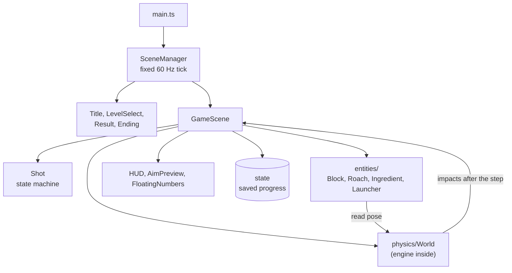
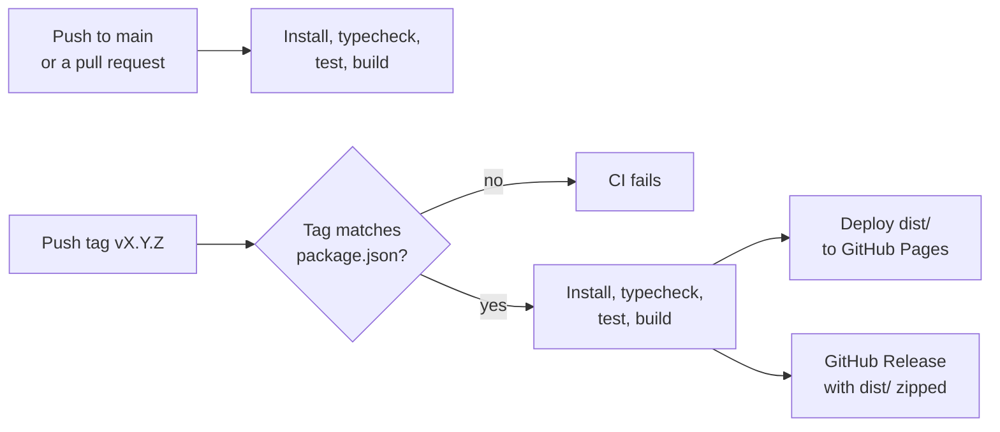

# Technical Reference

Stack, architecture, conventions, rendering, and tooling: how the code is built. The simulation itself: [physics.md](physics.md).

## Stack

| Tool | Version | Notes |
| ---- | ------- | ----- |
| TypeScript | 6.0.3 | `strict`; `vite/client` types come from `tsconfig.json`; `erasableSyntaxOnly`. |
| Vite | 8.3.2 | `vanilla-ts`; serves `public/` at the site root. Builds with a relative base (`--base=./`), so the game runs under any path, such as GitHub Pages. |
| Vitest | 5.0.3 | Tests; uses Vite's resolution, so tests import modules as the game does. |
| p5.js | 2.3.4 | **Instance mode only** (`new p5(sketch)`); rendering and input only, never physics. Friendly errors off in production builds. |
| Matter.js | 0.20.0 | `matter-js` with `@types/matter-js` 0.20.2; imported only by `src/physics/` ([physics.md](physics.md)). |
| pnpm | 12.3.4 | Pinned via `packageManager`. |
| Node.js | ≥ 22.12 | Required by Vite 8. |

Dependencies are pinned exactly (`pnpm-workspace.yaml`: `saveExact: true`). No new runtime dependency without approval.

## Project structure

```
fork-and-fling/
├── index.html            # page shell: the #game frame
├── package.json          # scripts, exact dependency versions, packageManager
├── pnpm-lock.yaml
├── pnpm-workspace.yaml   # pnpm settings (saveExact)
├── tsconfig.json
├── .prettierrc           # Prettier with its defaults
├── .githooks/            # commit-msg, pre-commit
├── .github/workflows/    # ci.yml: checks; tags deploy to GitHub Pages and publish a release zip
├── LICENSE
├── README.md             # what the game is and how to run it
├── docs/
├── public/assets/        # illustrations/, sounds/, fonts/
└── src/
    ├── main.ts           # creates the p5 instance, delegates to SceneManager
    ├── style.css         # page styles, letterboxed canvas
    ├── config.ts         # every tunable number, MATERIALS, ROACHES, INGREDIENTS, PALETTE, KEYS
    ├── assets.ts         # the asset list and the loader
    ├── state.ts          # saved progress
    ├── types.ts          # shared types, LevelDef
    ├── i18n/             # en.ts, es.ts, index.ts (detection, t())
    ├── core/             # Scene, SceneManager, Input, display, drawing, math, random, storage (theme-agnostic)
    ├── physics/          # World, BodyHandle, damage, blast; the only folder that imports Matter.js
    ├── entities/         # Entity, Destructible, Block (+ looks), Ground, Roach, Ingredient (+ kinds), Launcher
    ├── systems/          # Shot, Scoring, Blasts, Debris
    ├── levels/           # *.json level files, index, buildLevel, validateLevel
    ├── ui/               # Kitchen (background), HUD, AimPreview, FloatingNumbers, Button, PauseMenu
    ├── scenes/           # Title, LevelSelect, Game, Result, Ending
    └── debug/            # dev server with ?debug=true only
```

## Code conventions

- **Language:** code, comments, identifiers, file names, and commits in English. Player-facing strings only from `src/i18n/`; `es.ts` is typed against `en.ts`.
- **Formatting:** Prettier defaults: double quotes, semicolons, 2-space indent, trailing commas, 80 columns. `.prettierrc` pins them for every editor, the editor formats on save, and code in docs follows the same style.
- **Blank lines** split a body into its logical steps: a guard, setup, the work, the result. In tests they separate arrange, act, and assert.
- **Named values:** no TypeScript `enum` (`erasableSyntaxOnly` forbids it); use an `as const` object and derive the type: `const SHOT = { loading: 0, aiming: 1, flying: 2, settling: 3 } as const; type ShotState = (typeof SHOT)[keyof typeof SHOT];`.
- **Neutral core:** `core/` and `physics/` know nothing about kitchens; themed names (`Roach`, `Ingredient`, `MATERIALS.jelly`) start in `entities/`.
- **Tests** sit next to their module (`damage.test.ts` beside `damage.ts`). Test pure logic (aim and trajectory, damage, blast falloff, scoring and hats, level validation, the shot's state machine, the camera, `t()`), the level data, and one headless simulation per level ([level-design.md › Validation](level-design.md#validation)). Don't test drawing.

## Architecture

- **`main.ts` is minimal:** `setup` and `draw` only create and call the `SceneManager`.
- **Scenes** implement `enter()`, `update()`, `draw()`, `exit()`. `SceneManager.change(next)` calls `exit()` then `enter()`.
- **`GameScene`** owns one `World`, the entity lists, and the `Shot`. Restarting a level throws the world away and builds a new one from the `LevelDef`.
- **Entities** extend `Entity` (`alive`, `update()`, `draw(p)`). Physical ones hold a `BodyHandle` and read their pose from it. `Destructible` owns hp, `damage(amount)`, the damage state, and the hit flash; `Block` and `Roach` extend it. `Ingredient` has a kind and an ability.
- **Contacts flow one way:** `World` collects impacts during the step; after it, `GameScene` maps each `BodyHandle` to its entity (`Map<BodyHandle, Destructible>`), applies damage, queues blasts, and removes the dead. Nothing changes the world inside a callback.
- **The `Shot`** is a small state machine ([gameplay.md › The shot](gameplay.md#the-shot)); it knows the world only through a narrow interface (`isStill()`), so it's tested without an engine.
- **Shared math** (vectors, clamps, easing, the aim trajectory) lives in `core/math.ts`, never copied into an entity.
- **Tests run in Node** with no canvas: anything they import must not need p5 at load time, so modules import p5 only as a type (`import type p5 from "p5"`), except `main.ts`.
- **The p5 instance is passed explicitly**, never stored globally.



| Value | Lives in |
| ----- | -------- |
| Tunable numbers, material, roach, and ingredient tables, palette, keys | `config.ts` |
| Saved progress | `state.ts` + `localStorage` |
| Shared types, `LevelDef` | `types.ts` |
| Level content | `src/levels/*.json` |
| Per-level runtime (world, entities, shot, score) | `GameScene` fields |

### Global state

```ts
{
  progress: Record<string, LevelProgress>; // by level id ("2-3"): { bestScore, hats }
  introsSeen: Set<PlaceId>;                // places whose Intro has played
}
```

Saved as JSON under `forkfling.progress` (`try/catch`: blocked storage only stops it from persisting). The language is saved apart, under `forkfling.lang`. Unlocks are derived from `progress`, never stored.

## Runtime conventions

- **Time is in frames.** A fixed 60 Hz tick; `deltaTime` only feeds the accumulator ([physics.md › The step](physics.md#the-step)). Seconds are converted in `config.ts` (`0.5 s` → `30`).
- **Canvas:** **Decision (open):** 960 × 540 logical px (16:9), scaled to fit the window, letterboxed. `core/display.ts` sets only the canvas's CSS size; the game never sees the scale.
- **Two coordinate spaces:** level space (px, from the level data: `x` right, `y` down, the floor's top at `y = 0`) and screen space. In the MVP the view is fixed: level space is screen space shifted down by `FLOOR_SCREEN_Y`, applied once in `GameScene.draw()` and once to the pointer in `GameScene`. `Input` itself stays theme-agnostic: its `pointer` is in logical screen px, which the menus use as is. A `Camera` (pan, zoom) comes after the MVP, with wider levels.
- **Vectors:** plain `Vec = { x, y }`, never `p5.Vector` or engine vectors outside `physics/`.
- **Input:** pointer events on the canvas (mouse and touch the same way), converted from CSS px to logical px; a press is kept until the next tick ends, so a frame that runs no tick never loses it; keys by `KeyboardEvent.code` with `preventDefault()` on game keys; everything released on `blur`.

## Rendering

- Bodies: `p.push()`, `translate(pos)`, `rotate(angle)`, draw the shape centered, `p.pop()`.
- The camera transform is applied once per frame around the world draw; the HUD draws after, in screen space.
- Never `tint()` per frame; draw states as shapes, or prebuild variants.
- **Loading:** p5 2.x has no `preload()`. `assets.ts` loads every file once, in an async `setup`, with `Promise.all` (a missing file fails the load, never an `undefined` typed as an image). Paths are relative (`assets/...`). `assets.test.ts` checks the lists against the disk. The MVP loads only its font.

## Tooling

| Command | Does |
| ------- | ---- |
| `pnpm dev` | Dev server with hot reload. |
| `pnpm typecheck` | `tsc --noEmit`; run after every change. |
| `pnpm test` | Run the tests once (`vitest run`); `pnpm vitest` watches. |
| `pnpm build` | Typecheck and build to `dist/` (`tsc && vite build --base=./`). |
| `pnpm preview` | Serve the build. |

`package.json` also has `"prepare": "git config core.hooksPath .githooks || true"`, so `pnpm install` turns the hooks on.

### Debug tools

On the dev server only, with `?debug=true`; `main.ts` loads `src/debug/` behind `import.meta.env.DEV`, so the build drops it. Everything about them: [debug.md](debug.md).

### Git

- **[Conventional Commits](https://www.conventionalcommits.org/):** `<type>(<scope>): <summary>`, imperative, lowercase, no trailing period.
  - Types: `feat fix refactor perf style docs test build chore`.
  - Scope is optional: the `src/` folders (`core`, `physics`, `entities`, `systems`, `levels`, `ui`, `scenes`, `debug`, `i18n`) plus `config`, `state`, `ci`, `deps`, `release`.
  - Header of 72 characters or fewer, and a blank line before the body.
  - Breaking changes: `!` after the type/scope and a `BREAKING CHANGE:` footer.
- **One logical change per commit;** the game must typecheck and run at every commit.
- **Hooks** (`.githooks/`, activated by `pnpm install` through `prepare`): `commit-msg` validates the message, `pre-commit` runs `pnpm typecheck`. Never bypass them with `--no-verify`.
- **Versioning:** [SemVer](https://semver.org/) in `package.json`. While in `0.x`, each completed plan step bumps the minor version and fixes bump the patch. Releases get their own commit (`chore(release): vX.Y.Z`, checked against `package.json` by the hook) and an annotated tag `vX.Y.Z`. `1.0.0` = all five places playable through the ending.
- Only the project owner pushes.

### CI and deploy

`.github/workflows/ci.yml` runs on every push to `main` and every pull request: install with the frozen lockfile, typecheck, test, build. Pushing a `vX.Y.Z` tag runs the same checks, fails if the tag doesn't match the `package.json` version, deploys `dist/` to GitHub Pages, so the published game is always a release, and creates a GitHub Release with `dist/` and the `LICENSE` zipped as `<repository>-vX.Y.Z.zip`, to play offline. The zip must be served (for example `python3 -m http.server` inside it), since browsers refuse module scripts and font loads from `file://`; the release notes say so.



One-time setup on GitHub:
- **Settings › Pages › Source:** GitHub Actions.
- **Settings › Environments › github-pages › Deployment branches and tags:** add a tag rule `v*` (by default only the default branch may deploy).
